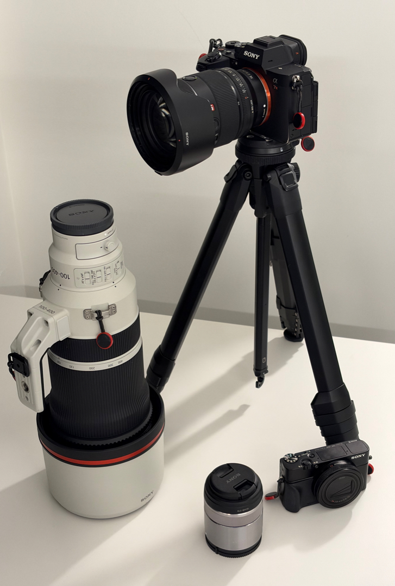
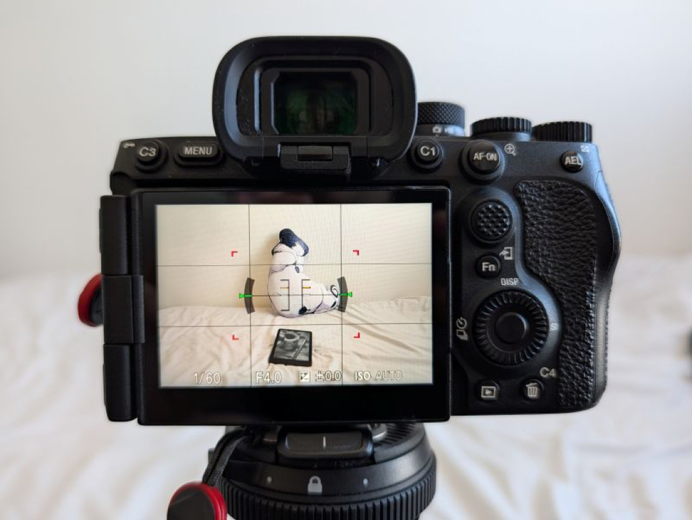

I've been a photography hobbyist since 2016, mostly specializing in urban photography and seeking the cinematic flair in everyday settings. You can find my pictures on [this site](/photos), [Twitter](https://x.com/errai/), and [BlueSky](https://bsky.app/profile/errai.bsky.social/).

I've used several mirrorless cameras and lenses over the course of my career. While the camera doesn't make the photographer, there's value in knowing your tools and how to use them.

Here is a list of cameras, lenses, and accessories I currently use, or have used in the past.

## My current setup

| Type           | Model                         | Pros                                                                | Cons                                       |
| -------------- | ----------------------------- | ------------------------------------------------------------------- | ------------------------------------------ |
| Camera         | Sony a7RV                     | Weather-sealed, fast focus, good controls, great stabilization.     | Clumsy menus.                              |
| Lens           | Sony FE 24-70mm F2.8 GM II    | Lightweight and sharp at all ranges.                                | So clinical it's a bit boring.             |
| Telephoto Lens | Sony FE 100-400mm F4.5 GM OSS | Great range, magical rendering.                                     | Bulky and heavy. Bad for travel.           |
| Macro Lens     | Sony E 30mm F3.5 Macro        | Cheap, light, and convenient.                                       | Not very sharp.                            |
| Camera         | Sony RX100 VII                | A pocketable body with a 24-200mm range. Great for every-day usage. | 1" sensor. Bad image quality in low light. |
| Tripod         | Peak Design Travel Tripod     | Shrinks to a very compact form.                                     |

## Camera control mapping

I spent a good amount of time researching ideal customizations to improve my shooting experience. Below is what I use on the a7RV.

figure(filename="bodyfocus.jpg", caption="Pressing C1 overrides the focus area with a small centered one.")

| Control      | Mapping                                                                   | Goal                                                              |
| ------------ | ------------------------------------------------------------------------- | ----------------------------------------------------------------- |
| AF-ON        | Focuses on the currently selected area.                                   | Back-button focus is more reliable than using the shutter button. |
| C1           | While held, overrides the current focus area with a small centered point. | Quickly focus on a small subject in a busy frame.                 |
| C2           | Cycles through wide, full, and tracking focus areas.                      |
| C3           | Opens the focus mode switcher.                                            |                                                                   |
| Joystick     | Moves the currently selected focus area.                                  | Focus on non-centered subjects.                                   |
| Disp         | Cycles between screen on and off.                                         | Saver a lot of battery life.                                      |
| Touch screen | Disabled.                                                                 | Prevent accidental inputs.                                        |

## Other cameras and lenses I owned

It took me several years to reach my current configuration. Most of the process wasn't about upgrades, as much as trying out many lenses to find what type of photography I wanted to focus on.

- **Sony Alpha 6300**: my first camera ever. I didn't know what cropped sensor was or what I wanted to shoot. I miss how portable it was sometimes.
- **Zeiss Touit 1.8/32**: my first lens ever. It was sharp, but not that great: the auto-focus was slow and noisy.
- **Sony E 10-18mm F4**: my first zoom lens. Except, it being 15mm-27mm, it was way too wide for my needs.
- **Sony APS-C E 18–135mm F3.5-5.6**: my favorite and last cropped sensor lens I owned. Great focal range, form factor and cost. It helped me realize I mostly shot at the extreme ends of the focal range.
- **Sony FE 70-200mm F4 G**: this was my gateway to upgrade from APS-C to full frame. It was a decent lens, but bulky and blurry around the corners.
  - I bought it used and it had dust in the lens element, causing spots to appear at f/9 or above. I ended up returning it.
- **Sony a7RIV**: my first full-frame camera. Compared to the a7RV, it had worse IBIS and eye-tracking, and much worse startup time.
- **Sony FE 200-600mm F5.6-6.3 G**: one of my favorite lenses, and for a while, the only one I used.
  - I was a much shyer photographer, preferring to keep my distance from the subject.
  - I absolutely loved the perspective compression of shooting at 600mm (or 1200mm, with a teleconverter).
  - It was an ideal lens for me, and helped me get into bird photography.
  - The main downside: it's heavy and bulky, and not the sharpest. But I still miss it sometimes.
- **Sony FE 12–24mm F4 G**: My first full-frame wide angle, while trying to get a lighter lens than the 200-600mm.
- **Sony FE 16-35mm F2.8 GM**: My first GM lens I rented for a while, which taught me that the price premium was not only about the extra light, but also image quality as a whole, and by a drastic amount.
  - This is also when I bought the Sony FE 70-200mm F2.8 GM II. I knew right away it was a keeper.
- **Sony FE 12-24mm F2.8 GM**: I got this used for a really good price, and used it for a few years.
  - While some 12mm shots turned out dramatic and gorgeous, it was really too wide for most occasions.
- **Sony FE 400-800mm F/6.3-8 G**: Huge, heavy, and really slow at 800mm, even in good light conditions. I would only recommend this for bird photographers with a healthy lower back.
- **Leica M10**: I wanted something lighter and more portable for daily use. I tried it out for one day with the 50mm Summicron.
  - While I enjoyed the clean interface, solid build, image quality (and blueish tint), and rangefinder experience, I couldn't justify its price.
- **Fujifilm X100VI**: My next iteration in the compact area.
  - I liked the form factor, but it wasn't quite as portable as I hoped for.
  - The fixed 35mm lens, while fast, felt limiting for my style.
  - Also, as a RAW shooter, the "recipes" aimed to replicate film look felt like a premium I wasn't using.
- **Sony RX100 VII**: My last small camera. I returned it since the viewfinder was defective, but it sported the features I wanted: actually pocketable and a 24-200mm effective focal range.
  - Pretty bad in low-light, even at ISO 3200. Noise removal helps, but still.
  - Not dust or weather proof. I would only use it as EDC.
  - I might buy another one at some point, but I'm hoping for a new version to come out.
