I've been a photography hobbyist since 2016, mostly specializing in urban photography and seeking the cinematic flair in everyday settings. You can find my pictures on [my site](/photos), [Twitter](https://x.com/errai/), and [BlueSky](https://bsky.app/profile/errai.bsky.social/).

I've used several mirrorless cameras and lenses over the years. While the camera doesn't make the photographer, there's value in knowing your tools and how to use them.

Here is a snapshot of my current setup, what I've used in the past, and my photography process.

- [Sony a7RV](#sony-a7rv)
- [Sony RX100 VII](#sony-rx100-vii)
- [Sony FE 24-70mm F2.8 GM II](#sony-fe-24-70mm-f28-gm-ii)
- [Sony FE 100-400mm F4.5-5.6 GM OSS](#sony-fe-100-400mm-f45-56-gm-oss)
- [Sony E 30mm F3.5 Macro](#sony-e-30mm-f35-macro)
- Peak Design Travel Tripod

## My gear over time

It took me several years to reach my current configuration. Most of the process wasn't a direct upgrade, as much as lateral moves while trying out many lenses and ranges to find what type of photography I wanted to focus on.

### Sony Alpha 6300

My very first camera. At the time, I didn't know what a cropped sensor was or what I actually wanted to shoot.

Also, it didn't have in-body stabilization, and the menu system kinda sucked. Still, sometimes I miss it, as it helped me fall in love with photography.

### Zeiss Touit 1.8/32

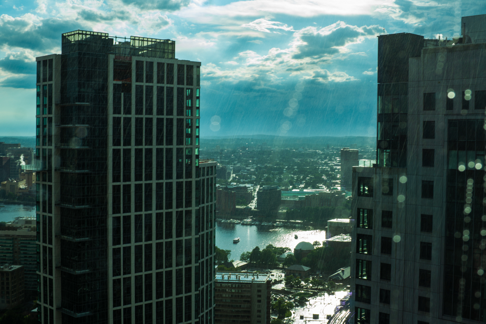
My very first lens. Sharp optics, but a slow, noisy autofocus motor.

### Sony E 10-18mm F4

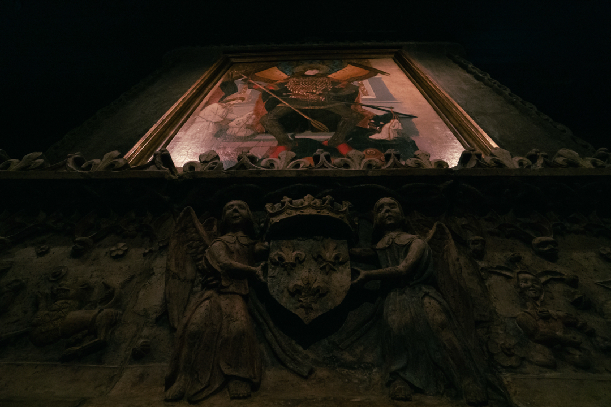
My first zoom lens, before I even knew what a wide angle was. It proved far too wide at the time.

### Sony APS-C E 18-135mm F3.5-5.6

My favorite APS-C lens. Great focal range, lightweight, and inexpensive, but the build quality felt a bit plasticky.

Using this zoom helped me realize I spent almost all my time shooting at the extreme ends of the range rather than the middle, and that I really liked longer focal lengths!

### Sony E 30mm F3.5 Macro

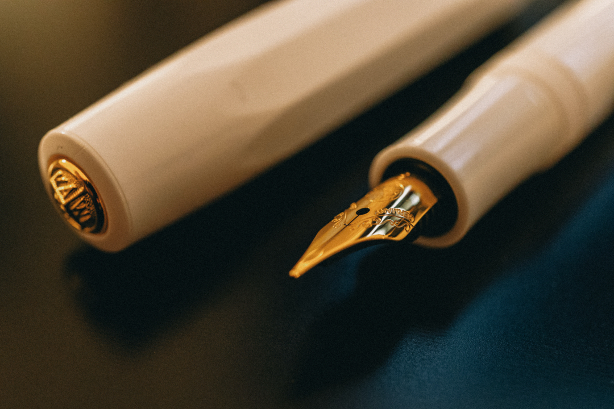
Cheap, light, and convenient for macro shots. Very inexpensive. I don't use it often at all.

### Sony FE 70-200mm F4 G

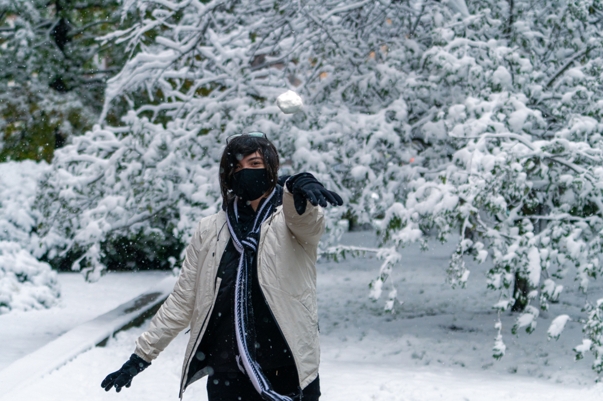
Leaning into that preference for reach, this served as my transition lens from APS-C to full-frame. Decent image quality, but bulky with visible corner softness. The copy I bought had dust inside, so I ended up returning it.

Also, I realized that using a full-frame lens on a cropped sensor camera didn't make that much sense, so...

### Sony a7RIV

My first full-frame camera body, with a 61-megapixel sensor, solid IBIS, and more bells and whistles than I knew what to do with at the time.

### Sony FE 200-600mm F5.6-6.3 G

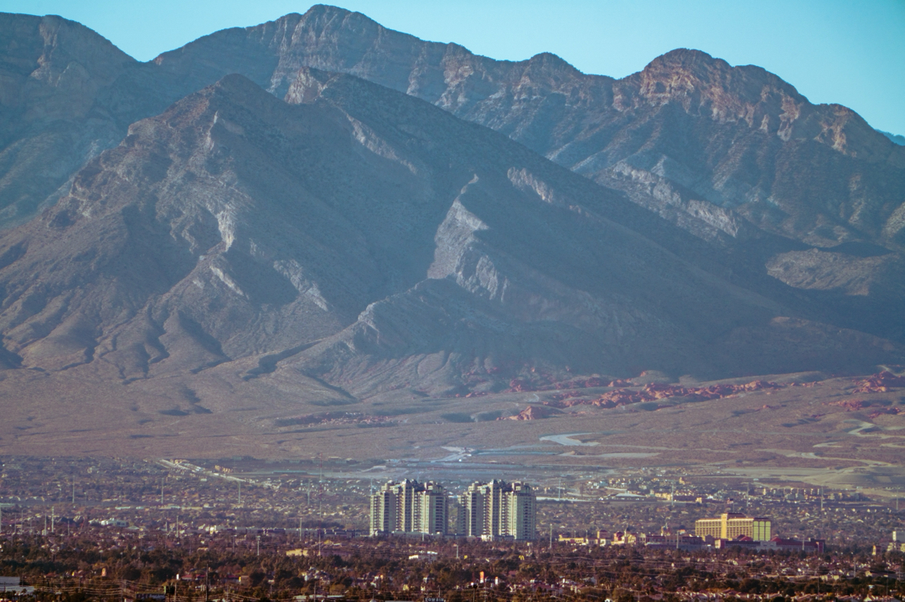
With full-frame resolution ready, I dove straight into super-telephoto. This became one of my all-time favorite lenses and, for a while, the only one I used. I was a shyer photographer back then and preferred shooting from a distance.

The perspective compression at 600mm (or 1200mm with a 2x teleconverter) was addicting and got me into bird photography.

My copy wasn't razor-sharp, and it was large and heavy, so I wanted something smaller at the other side of the spectrum.

### Sony FE 12-24mm F4 G

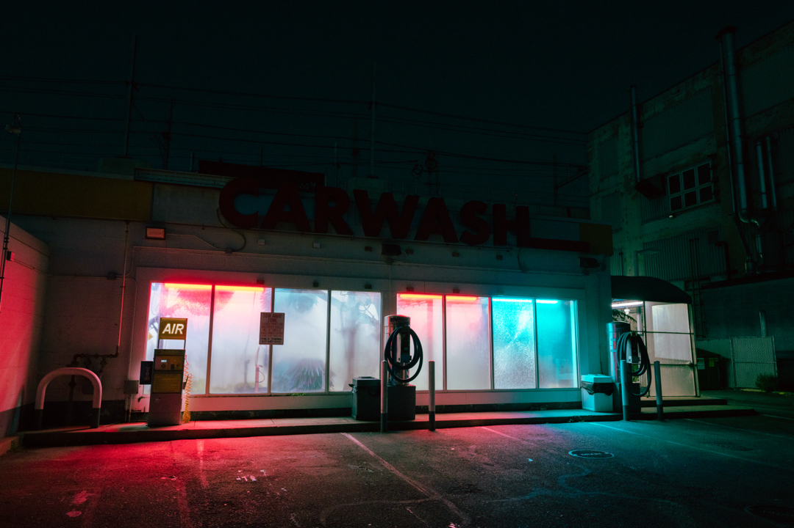
My first full-frame ultra-wide, when I was trying to find a lighter alternative to my telephoto. However, the image quality wasn't very impressive, and it felt a bit too wide at the time, so I returned it.

### Sony FE 16-35mm F2.8 GM

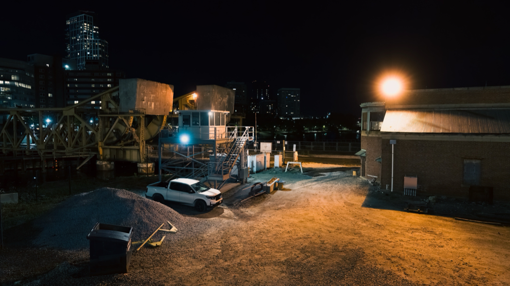
Wanting better performance in a wide zoom, the first G Master lens I rented taught me that the GM price premium was not only about the extra light, but also image quality as a whole, and by a drastic amount.

Optically impressive, but I found myself almost always shooting at 35mm, which suggested I wanted something narrower.

### Sony FE 24-70mm F2.8 GM

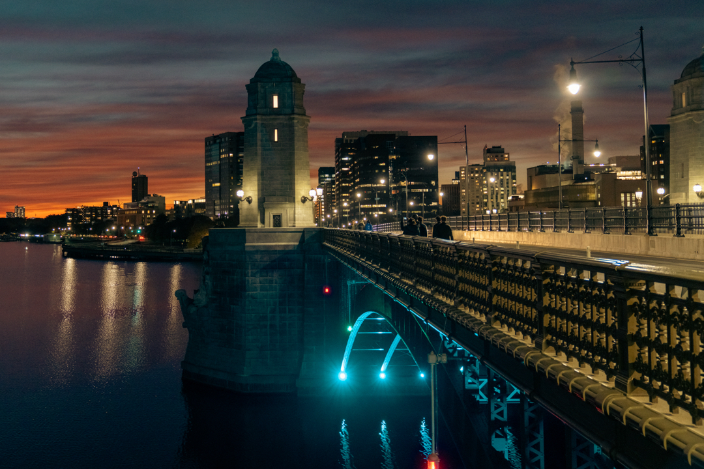
Moving into standard framing, this ended up being my workhorse for quite some time. Extremely versatile with great image quality, but a bit heavy for casual everyday carry (which the GM II version vastly improved).

### Sony FE 70-200mm F2.8 GM II OSS

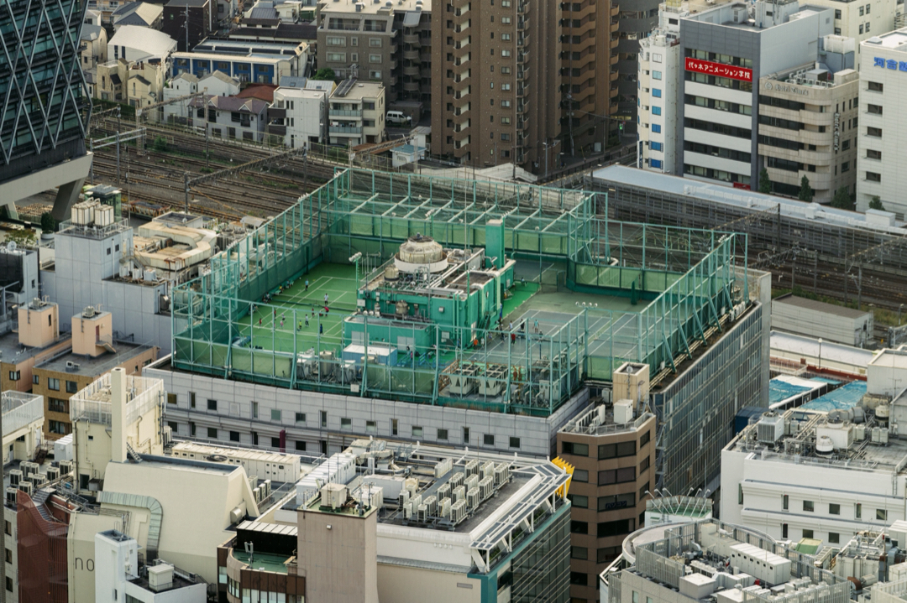
To complement the 24-70mm, I added perhaps my all-time favorite lens, the one I owned for the longest, and my top choice if I could only own a single model.

Incredibly sharp across the frame, and exceptional autofocus. Surprisingly compact for the range and speed.

### Sony FE 12-24mm F2.8 GM

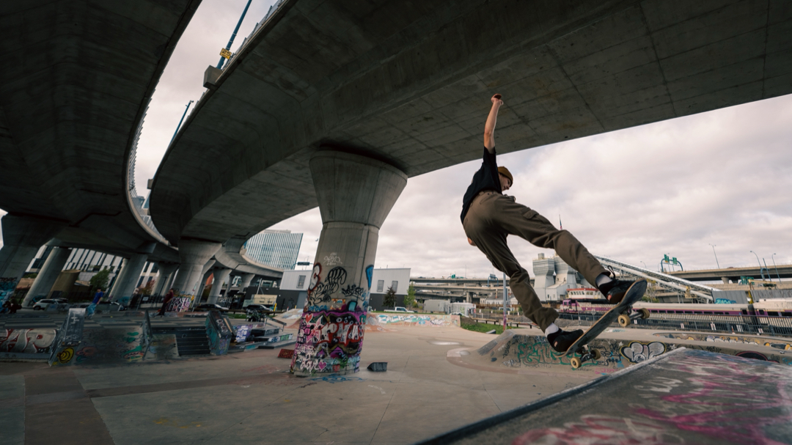
This completed the "GM triangle" at the time. I bought it used at a great discount, and kept it for a few years. But, while I loved shooting at 12mm, it was too specialized to warrant keeping.

### Sony a7RV

With my lens lineup set, this upgrade from the a7RIV introduced an articulating display, better dynamic range, better in-body stabilization, and dramatically improved startup times.

While battery life was actually worse than the previous model, being able to turn the camera off and on without missing a shot was a great improvement.

### Sony FE 400-800mm F/6.3-8 G

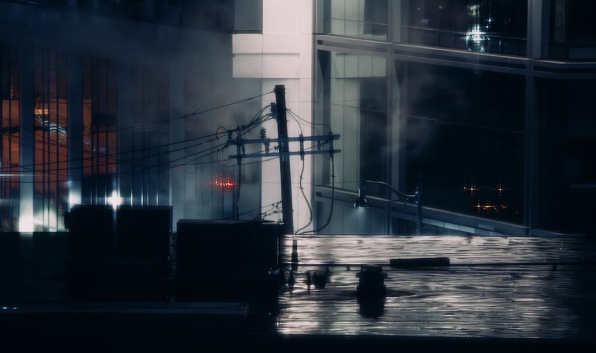
Chasing that 200-600mm reach again, I only owned this for a few days. While the 800mm without a teleconverter was massive, it was enormous, heavy, and way too slow.

### Leica M10 + 50mm Summicron

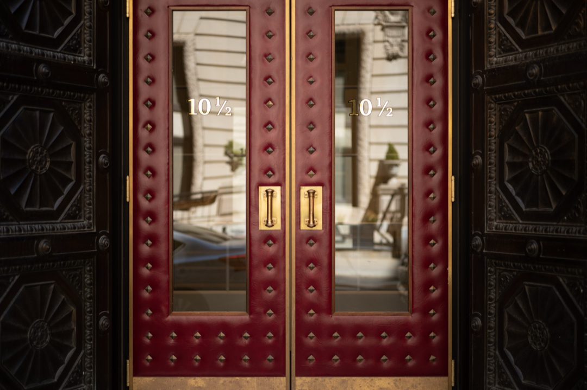
This was when I started wanting a small, secondary camera for daily use, so I tested this kit for a day.

Sexy design, distinct lens character, and shooting with the rangefinder was fun, but it was too expensive to justify keeping.

Still, if I can find a used model at a reasonable price, I might get one again!

### Fujifilm X100VI

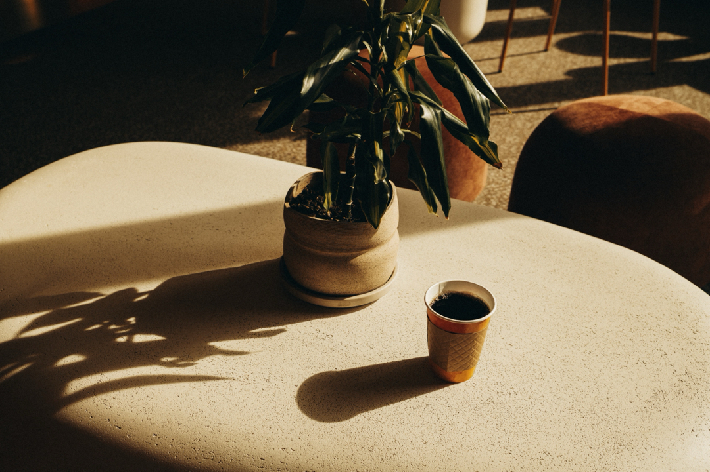
My next experiment in fixed-lens compacts.

Honestly, I wasn't a fan. Not only did the 35mm field of view feel restrictive, but it wasn't really pocketable. Also, since I shoot RAW, the built-in film simulations were useless to me.

I sold it a few months after buying it and settled for...

### Sony RX100 VII

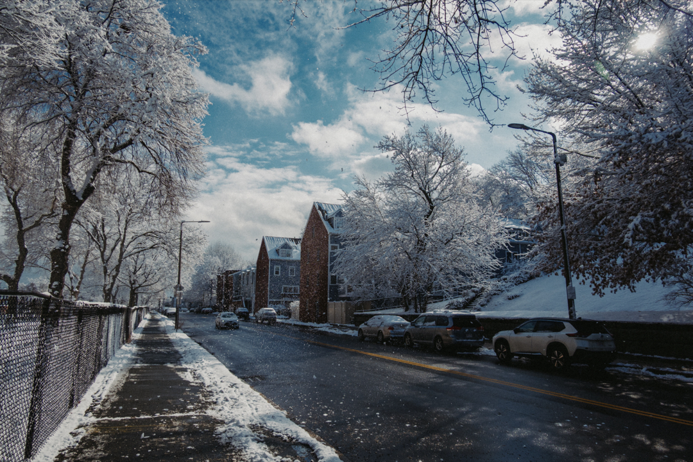
A truly pocketable camera with flash, a viewfinder, and a 24-200mm range. While the first model I got was defective, I snagged a used one in great condition.

The main downside is that the 1-inch sensor makes low-light shots extremely grainy even at ISO 1600. Also, it has no weather or dust sealing.

Still, it's my go-to for daily carry, and there's nothing else like it on the market.

### Sony FE 24-70mm F2.8 GM II

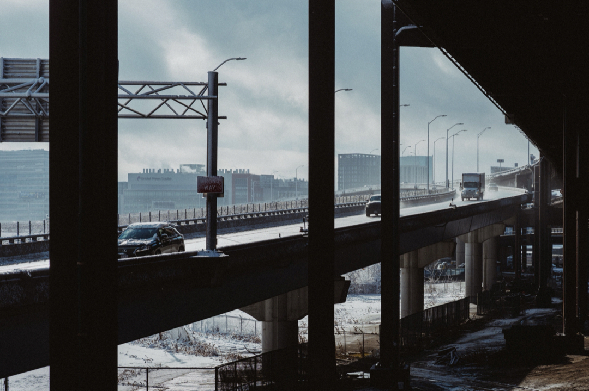
Back on the main camera, this became my main workhorse, which I found used at a great price. Some people say it's so clinical it's almost boring, but as a RAW shooter, I like having a clean slate to work off.

Most of my photographs are shot with this.

### Sony FE 100-400mm F4.5 GM OSS

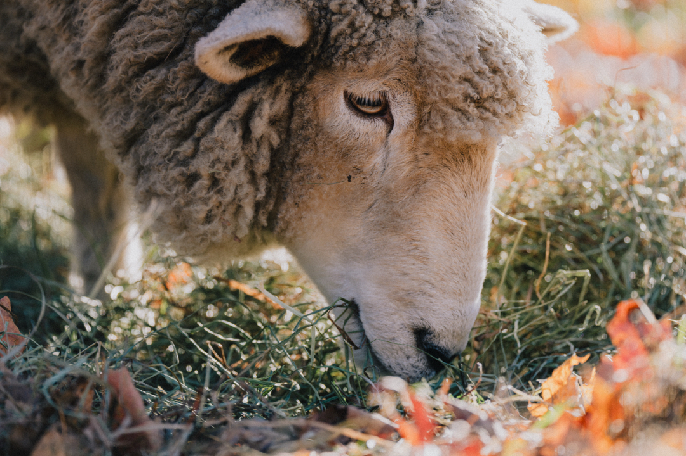
Having realized that most of my shots with the 70-200mm were concentrated at 200mm (while the 24-70mm had a healthy distribution), and that I mostly used it for nature photography rather than casual shooting, it felt like a good time for a focal range upgrade.

I wished for the image quality advancements of the recent GM lenses without incurring prime telephoto prices ($13,000+ for the 600mm), and this lens delivers! Beautiful, creamy bokeh and almost-magical rendering make shooting with it a pleasure.

While significantly larger and heavier than the 70-200mm, it sits at just the right size category for me to enjoy walking around with all day.

## Workflow

Owning gear and learning how to use it taught me a lot about what I like to shoot and how. Here's a breakdown of my method.

### Camera configuration and tips

- I always **shoot in RAW** and edit my photos in Lightroom. This means some settings like white balance, picture profiles, ISO, and even exposure compensation (to some degree) take the backseat, allowing me to focus entirely on aperture and shutter speed. This dramatically reduces the number of variables to account for while taking pictures!
- My dial is almost always on aperture priority, while I switch to shutter-first or manual mode for fast targets or intentional motion blur. I keep ISO to auto outside of long exposures.
- Give continuous drive mode a chance: it lets you capture multiple frames while holding down the shutter button.
- Since my shots often involve rectilinear perspective, I use a rule of thirds grid overlaid on the display and viewfinder to help me align the lens with each axis, as well as the occasional compositional value.
- Use auto-standby and turn off the display with one button when not shooting, it boosts battery life significantly.
- Don't delete photos from the camera. Sometimes outtakes end up being keepers once you review them later on a larger screen.

### Camera controls

I also spent a good amount of time researching ideal customizations to improve my shooting experience. Here are the more useful tweaks I've applied, while the rest are defaults or simple shortcuts.

| Control | Mapping                                                          | Goal                                                     |
| ------- | ---------------------------------------------------------------- | -------------------------------------------------------- |
| AF-ON   | Focus on the currently selected area.                            | More reliable than half-pressing the shutter button.     |
| AEL     | Hold to enter shutter-priority mode at 1/2000s with tracking on. | Shoot sudden fast-moving subjects like birds in flight.  |
| C1      | Hold to override the focus area with a small centered spot.      | Quickly focus on a small subject in a busy frame.        |
| C4      | Cycle through recognition targets.                               | Quickly switch between animal and human target tracking. |
| DISP    | Cycle between screen on and off.                                 | Save a lot of battery life.                              |

### Auxiliary tools

- I use Peak Design straps and anchors to carry the camera sling-style. For heavier lenses like the 100-400mm, to reduce strain on the camera mounts I attach one end of the strap to the lens's eyelet.
- I tried a number of camera bags and backpacks, but my kit changed too frequently to settle on one. At the moment, I have a Peak Design Sling 6L and a Veilance Anodic Backpack with an insert to keep a camera up-right inside. I occasionally also use the sling bag that came bundled with the 100-400mm.
- I don't accessorize much. No filters or cases, just one memory card for each camera, a couple of spare batteries, some lens cleaning wipes, and an air-blower to get dust off my gear.

### Process

Ahead of a session, I try to map out my route, the weather, potential wildlife, transportation, and the style of photography I want to focus on. Then, I pack as light as possible, avoiding bags altogether when I can (which is easier in the winter when jackets provide extra pockets). For conspicuous super-telephoto lenses, I almost always bring a backpack.

During the photoshoot itself, I'm mostly improvising. I try to take my time for each shot, and leisurely make my way towards the next destination, or wander if I don't have one. I seek out areas with strong chiaroscuro lighting and/or landscapes with little visual noise. I rarely interact with people.

If I have to switch lenses, I try to find a bench or a table to let the process go faster. I usually switch lenses 2-3 times during a session, if I bring multiple.

#### Editing

When I'm back home, I remove the SD cards from the cameras and import the RAW photos into Lightroom, while applying automatic lens correction profiles and converting the files to .dng.

I do a first pass to flag photos as keep or remove, then a second one to cull out duplicates when there are two or more good shots of the same subject.

When I start editing, if the photos were taken in low light, I apply a denoise pass to all of them. Then, based off the emotions I want to evoke, I pick my favorite shot of each sub-session and edit crop, white balance, curves, and occasionally color grading. Sometimes, I use presets from RNI as bases to recreate a film look.

Having nailed the "anchor shot" of each narrative, I apply similar settings to contiguous photos, in order to provide visual continuity -- Dreaminess, mystery, grunge, luxury, desolation, etc.

Lastly, I export the edited JPEG files in 4K resolution, upload them to the Cloud, pick my favorites, and post those, while keeping the rest as memories.

#### Printing

I've also gotten into the habit of printing my work. Initially, the idea was just to gift friends physical photos of themselves. I started with an Instax Mini printer, which quickly became unsustainably expensive at around $2 per print.

After doing some research, I switched to an Epson ET-8500 paired with high-gloss premium photo paper. This dramatically cut down per-print costs and inspired me to start keeping a binder as a visual diary of my days. A few months in, I am really happy with that decision.

## Conclusion

I started this journey without much thought, upgrading my kit step-by-step as I became more physically active and enamored with the world I photographed. Over time, I began spotting flaws in my older work while naturally refining techniques I never really thought of before.

Today, I'm happy to have made photography such a central hobby in my life. Aside from being challenging and fun, being an observer rather than an active participant suits my personality much better. Ultimately, it helped me broaden my tastes in aesthetics, and develop a passion for nature.

I encourage anyone who's on the fence to pick up a used APS-C camera and give it a try. It won't take long to find your own style and fall in love with the craft.
