import Nsfw from "/src/components/Nsfw.astro";

My online avatar is an anthro dragon I created in 2018 and redesigned a few times since. His nature is the same as mine, so he's more of an extension of me rather than an entirely separate persona.

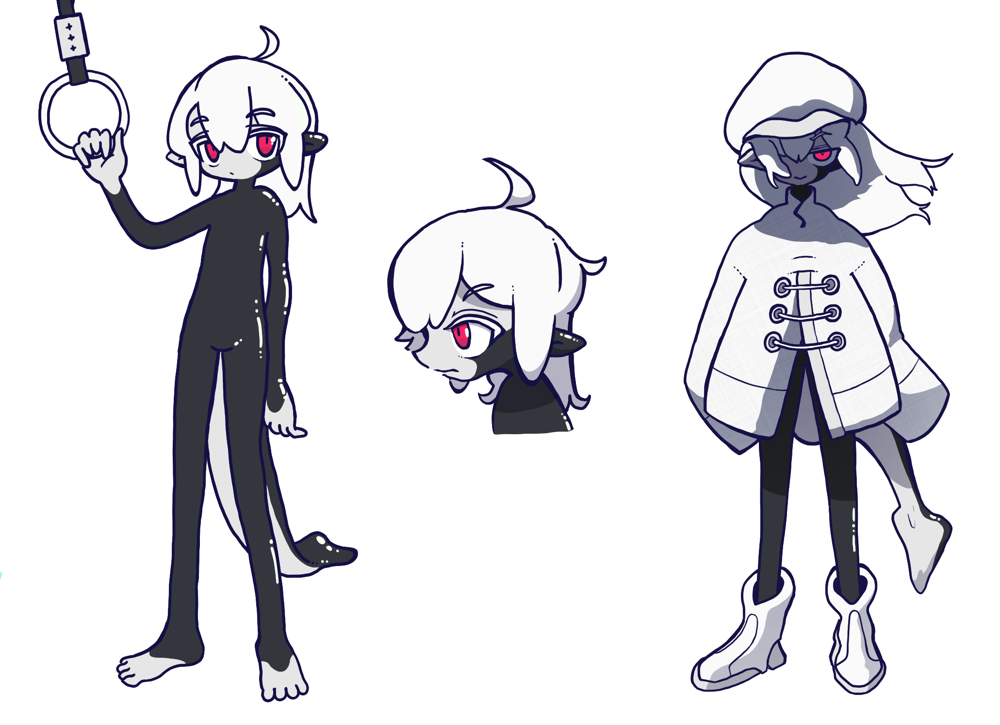

| Attribute   | Value                                          |
| ----------- | ---------------------------------------------- |
| Full name   | Errai Neon                                     |
| Species     | Dragon (originally human)                      |
| Gender      | Male                                           |
| Personality | Timid, curious, playful, teasy                 |
| Height      | 6'0                                            |
| Texture     | Glossy, slick                                  |
| Legs        | Plantigrade                                    |
| Outfit      | White boots, beastmaster jacket, oversized hat |
| Scent       | Vanilla, orange peel                           |
| Abilities   | Shapeshifting into a living suit or fluid      |

## Backstory

Errai is a human who found a mysterious pair of rings labeled HF-72.

When both rings are worn, they coat the user(s) in a gooey substance that turns them into a Living Latex monster with a form unique to the wearer.

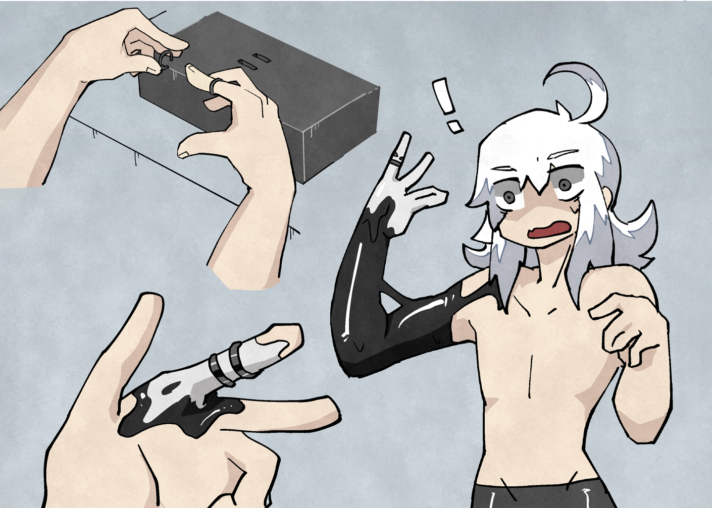
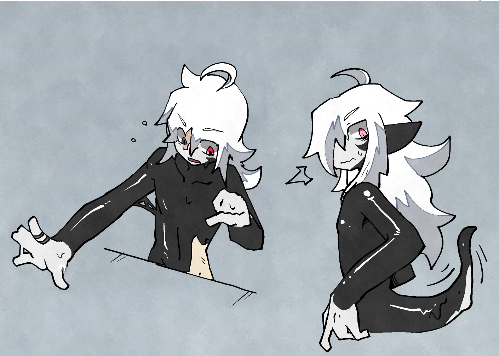
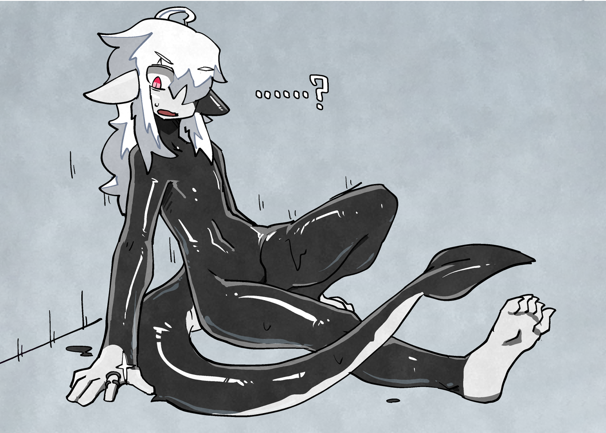

The transformation reverts a few hours after the rings are removed, but Errai prefers to stay in his LiLa form: an androgynous, short-snouted dragon with white hair, magenta eyes, and a spade-shaped tail.

## Canvas (non-canon)

Canvas is a role-playing setting my boyfriend and I have been developing for over five years.

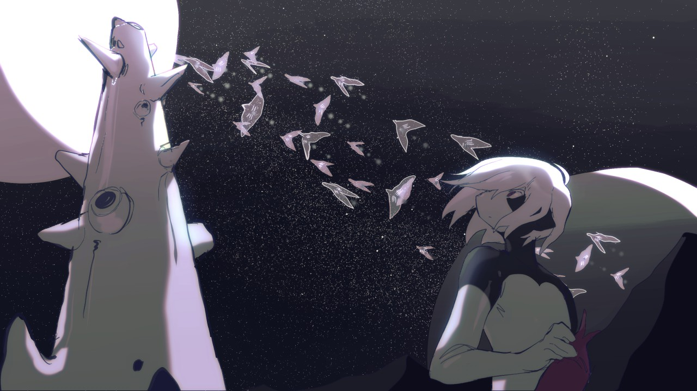

In this spinoff, Errai is a human turned creature-absorbing symbiote who took refuge on a space station and subsequently marooned onto a distant, hostile planet. Many years later, he meets Sketch, a crash survivor suffering from memory loss.

The two embark onto a (mostly improvised) journey across pale lands and mysterious ruins, trying to flee the planet and its vengeful wardens.

| Attribute | Value                                                         |
| --------- | ------------------------------------------------------------- |
| Species   | Unstable symbiote                                             |
| Nature    | An inconsistent mess (both in-universe and due to my writing) |
| Abilities | Photosynthesis, shapeshifting, absorbing hosts                |
| Likes     | Dumplings, experiments, Sketch                                |

## Amalgam (non-canon)

This section explores an alternate setting in which Errai is composed of two humans who are merged together through the rings.

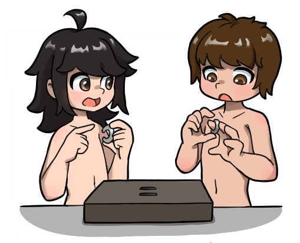
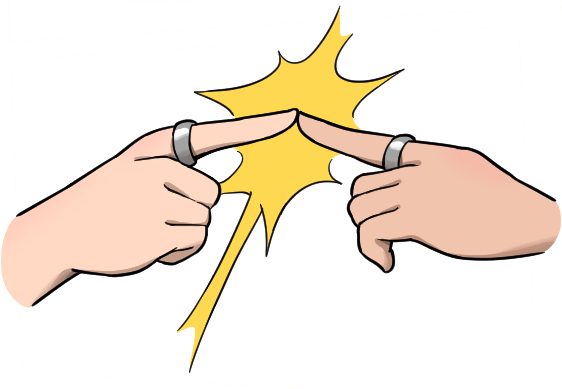
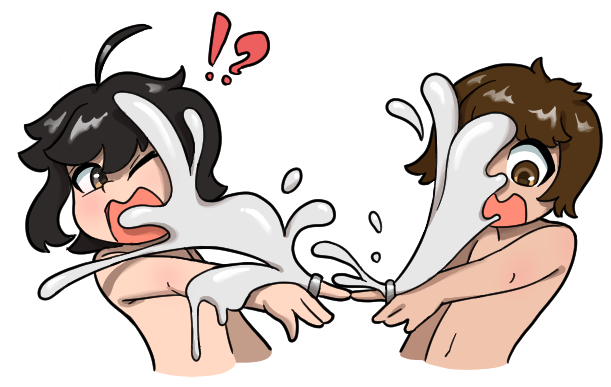
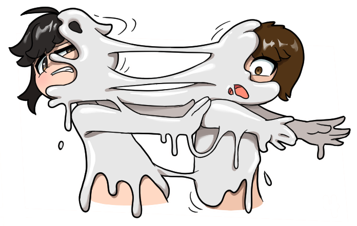

Subjects A and B awaken in a chamber sealed by a heavy vault door. They don't recall how they got there, or if they've met before.

The only objects inside the room are two rings. Upon wearing them, living latex spreads across their bodies and merges them into a LiLa dragon.

The door clanks open once the transformation is complete but, instead of leading outside, A and B find themselves in a larger wing of the same facility, and realize that losing their humanity was only the beginning.

### Experiment notes

| Visual                     | Observations                                                                            |
| -------------------------- | --------------------------------------------------------------------------------------- |
| 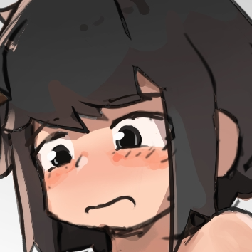  | Test subject A is hesitant, apprehensive, and meditative.                               |
| 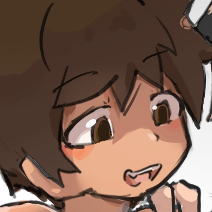  | Test subject B is dominant, overconfident, and energetic.                               |
| 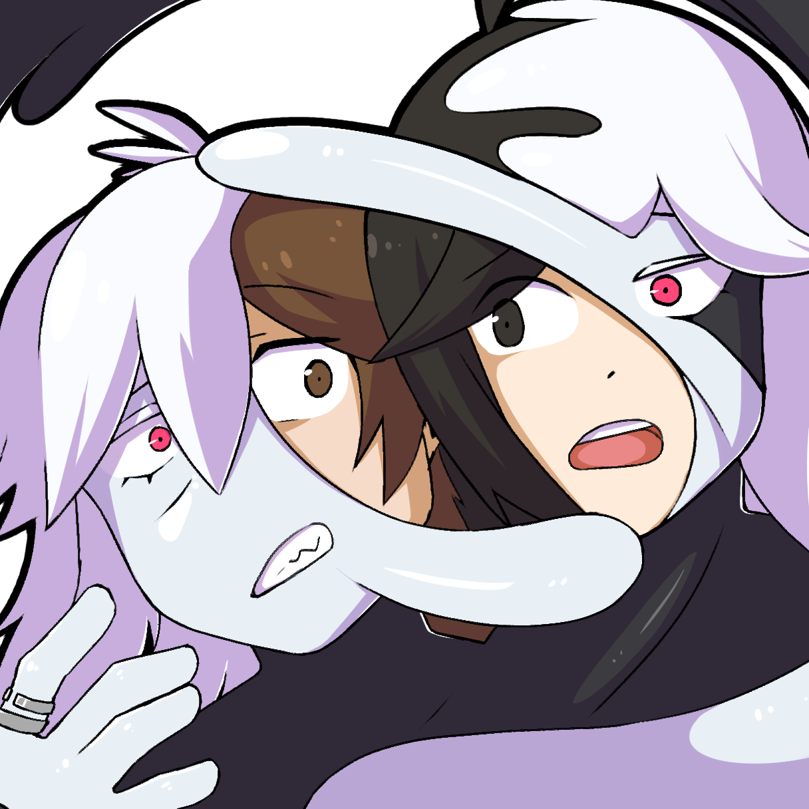 | The subjects' human bodies are permanently mixed together under the polymer.            |
| 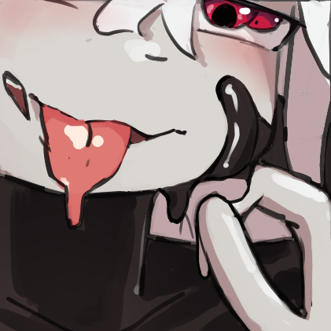    | Their merged form is physically unstable and able to recombine further with other LiLa. |
| 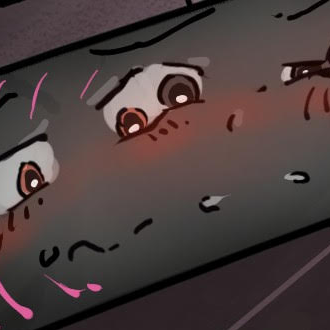      | Subjects retain their individual consciousnesses and share control of their new form.   |

